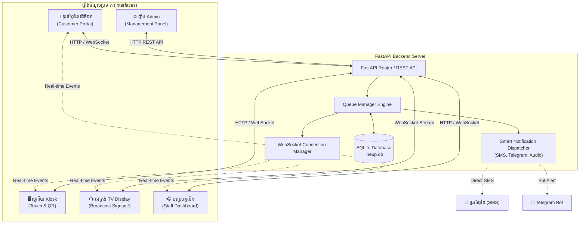
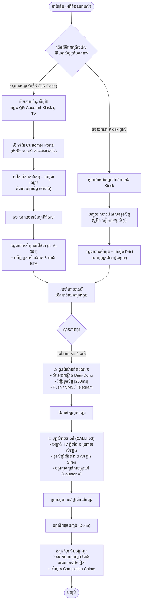
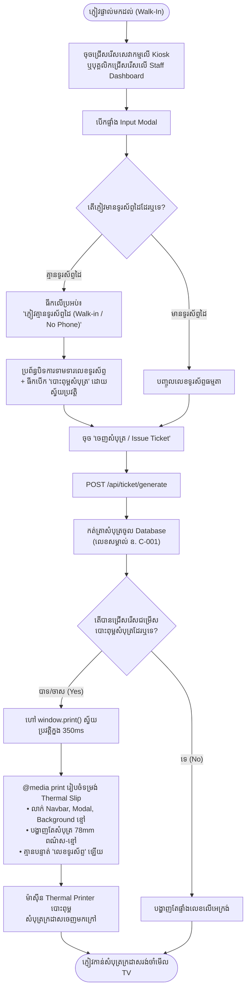
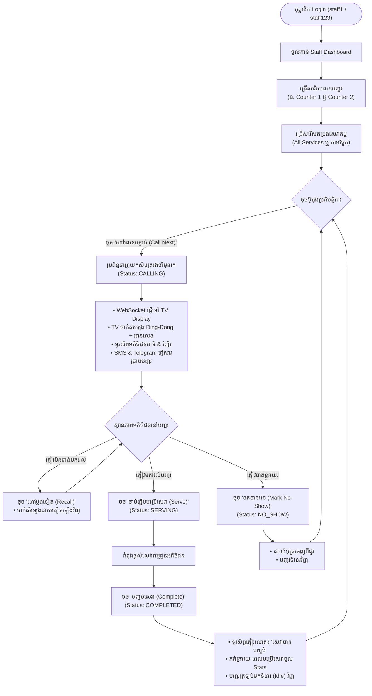
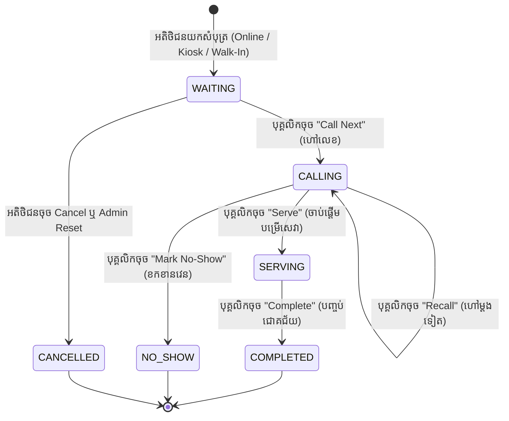
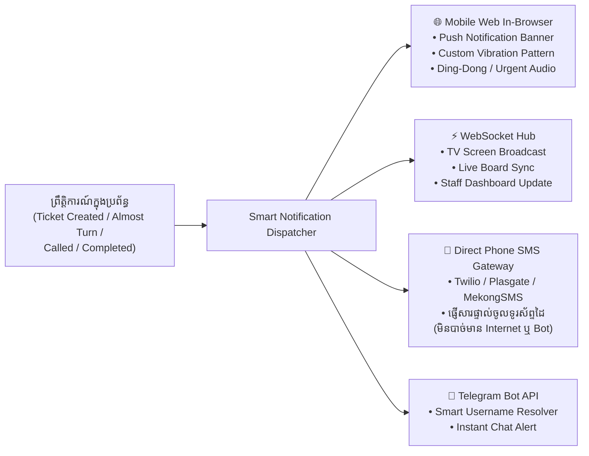

# 📖 សៀវភៅណែនាំការប្រើប្រាស់ប្រព័ន្ធ LineUp (User Guide & System Flowcharts)
### Smart Virtual Queue Management System
*គម្រោងបញ្ចប់ការសិក្សាថ្នាក់បរិញ្ញាបត្រ (Year 4 Final Project) • រៀបចំដោយ៖ ប្រព័ន្ធ LineUp*

---

## 📑 មាតិកា (Table of Contents)
1. [ទិដ្ឋភាពទូទៅនៃប្រព័ន្ធ (System Overview)](#១-ទិដ្ឋភាពទូទៅនៃប្រព័ន្ធ-system-overview)
2. [គំនូសបំព្រួញលំហូរដំណើរការ (System Flowcharts)](#២-គំនូសបំព្រួញលំហូរដំណើរការ-system-flowcharts)
   - [2.1 ស្ថាបត្យកម្មរួមនៃប្រព័ន្ធ (System Architecture Flowchart)](#21-ស្ថាបត្យកម្មរួមនៃប្រព័ន្ធ)
   - [2.2 លំហូរដំណើរការរបស់អតិថិជន (Customer Journey Flowchart)](#22-លំហូរដំណើរការរបស់អតិថិជន)
   - [2.3 លំហូរចេញសំបុត្រផ្ទាល់ & បោះពុម្ព (Walk-In & Thermal Printing Flowchart)](#23-លំហូរចេញសំបុត្រផ្ទាល់--បោះពុម្ព-walk-in--thermal-printing)
   - [2.4 លំហូរប្រតិបត្តិការរបស់បុគ្គលិកបញ្ជរ (Staff Counter Operation Flowchart)](#24-លំហូរប្រតិបត្តិការរបស់បុគ្គលិកបញ្ជរ-staff-operation)
   - [2.5 ដ្យាក្រាមវដ្តជីវិតសំបុត្រ (Ticket Lifecycle State Diagram)](#25-ដ្យាក្រាមវដ្តជីវិតសំបុត្រ-ticket-lifecycle)
   - [2.6 ប្រព័ន្ធជូនដំណឹងពហុបណ្តាញ (Multi-Channel Notification Dispatcher)](#26-ប្រព័ន្ធជូនដំណឹងពហុបណ្តាញ-notification-flow)
3. [ការណែនាំលម្អិតអំពីរបៀបប្រើប្រាស់ (Step-by-Step User Manual)](#៣-ការណែនាំលម្អិតអំពីរបៀបប្រើប្រាស់)
   - [3.1 ផ្ទាំងអតិថិជន (Customer Web App)](#31-ផ្ទាំងអតិថិជន-customer-web-app)
   - [3.2 ផ្ទាំងស្ថានីយស្វ័យប្រវត្តិ (Queue Kiosk Screen)](#32-ផ្ទាំងស្ថានីយស្វ័យប្រវត្តិ-queue-kiosk-screen)
   - [3.3 ផ្ទាំងទូរទស្សន៍ផ្សាយលេខសាធារណៈ (Public TV Display Board)](#33-ផ្ទាំងទូរទស្សន៍ផ្សាយលេខសាធារណៈ-public-tv-display)
   - [3.4 ផ្ទាំងបុគ្គលិកបម្រើសេវា (Staff Dashboard)](#34-ផ្ទាំងបុគ្គលិកបម្រើសេវា-staff-dashboard)
   - [3.5 ផ្ទាំងអ្នកគ្រប់គ្រងប្រព័ន្ធ (Admin Control Panel)](#35-ផ្ទាំងអ្នកគ្រប់គ្រងប្រព័ន្ធ-admin-control-panel)
4. [ការដំឡើង និងដំណើរការប្រព័ន្ធ (Installation & Run Guide)](#៤-ការដំឡើង-និងដំណើរការប្រព័ន្ធ-installation--run-guide)
5. [គណនីគំរូ និងសិទ្ធិចូលប្រើប្រាស់ (User Roles & Demo Accounts)](#៥-គណនីគំរូ-និងសិទ្ធិចូលប្រើប្រាស់-rbac)

---

## ១. ទិដ្ឋភាពទូទៅនៃប្រព័ន្ធ (System Overview)

**LineUp** គឺជាប្រព័ន្ធគ្រប់គ្រងជួររង់ចាំបែបឆ្លាតវៃ (Smart Virtual Queue Management System) ដែលត្រូវបានបង្កើតឡើងដើម្បីលុបបំបាត់ការឈរតម្រង់ជួរកកស្ទះនៅតាមធនាគារ គ្លីនិក មន្ទីរពេទ្យ ឬបញ្ជរសេវាកម្មនានា។

### 🔹 បច្ចេកវិទ្យាស្នូល (Tech Stack)
* **Backend:** Python 3.14 + FastAPI (High performance, Asynchronous)
* **Real-time Engine:** WebSockets (ធ្វើបច្ចុប្បន្នភាពទិន្នន័យលើគ្រប់អេក្រង់ភ្លាមៗដោយមិនបាច់ Refresh)
* **Database:** SQLite + SQLAlchemy ORM
* **Frontend:** HTML5, Tailwind CSS, Vanilla JavaScript, FontAwesome Icons
* **Audio & Voice:** Real Web Audio WAV chimes (Ding-Dong, Urgent, Completion) + Text-to-Speech Voice Engine
* **Printing Engine:** CSS `@media print` ស្ដង់ដារ POS Thermal Receipt (58mm / 80mm)
* **Public Tunneling:** Cloudflare Tunnel គាំទ្រការស្កេនពីទូរស័ព្ទដៃគ្រប់ Wi-Fi & 4G/5G

---

## ២. គំនូសបំព្រួញលំហូរដំណើរការ (System Flowcharts)

### 2.1 ស្ថាបត្យកម្មរួមនៃប្រព័ន្ធ



---

### 2.2 លំហូរដំណើរការរបស់អតិថិជន



---

### 2.3 លំហូរចេញសំបុត្រផ្ទាល់ & បោះពុម្ព (Walk-In & Thermal Printing)



---

### 2.4 លំហូរប្រតិបត្តិការរបស់បុគ្គលិកបញ្ជរ (Staff Operation)



---

### 2.5 ដ្យាក្រាមវដ្តជីវិតសំបុត្រ (Ticket Lifecycle)



---

### 2.6 ប្រព័ន្ធជូនដំណឹងពហុបណ្តាញ (Notification Flow)



---

## ៣. ការណែនាំលម្អិតអំពីរបៀបប្រើប្រាស់ (Step-by-Step User Manual)

---

### 3.1 ផ្ទាំងអតិថិជន (Customer Web App)
> **URL:** `http://localhost:8000/` ឬតាមតំណភ្ជាប់សាធារណៈ Cloudflare

#### របៀបយកសំបុត្រតាមទូរស័ព្ទដៃ ៖
1. **ស្កេន QR Code ៖** ភ្ញៀវបើកកាមេរ៉ាទូរស័ព្ទដៃស្កេន QR Code ដែលបង្ហាញលើផ្ទាំង TV ឬ Kiosk។
2. **ជ្រើសរើសសេវាកម្ម ៖** ចុចរើសសេវាកម្មដែលចង់បាន (ឧ. *ទូទៅ, ដក/ដាក់ប្រាក់, សេវាអតិថិជន, ឬ VIP*)។
3. **បំពេញព័ត៌មាន (ចាំបាច់) ៖**
   * **ឈ្មោះ (Name):** យ៉ាងតិច ២ តួអក្សរ។
   * **លេខទូរស័ព្ទ (Phone):** យ៉ាងតិច ៨ ខ្ទង់ (ដើម្បីទទួលបានសារ SMS ពេលដល់វេន)។
   * *(ជម្រើសបន្ថែម)*៖ អាចបញ្ចូល Telegram Username ដើម្បីទទួលសារតាម Telegram ផងដែរ។
4. **ចុច «ទទួលសំបុត្រឌីជីថល» ៖**
   * អេក្រង់នឹងបង្ហាញកាតសំបុត្រផ្ទាល់ខ្លួនភ្លាមៗ (ឧ. `A-001`)។
   * បង្ហាញចំនួនអ្នកនៅខាងមុខ និងម៉ោងប៉ាន់ស្មាន (ETA)។
5. **ពេលជិតដល់វេន (នៅសល់ <= 2 នាក់) ៖**
   * ទូរស័ព្ទនឹងរំញ័រ + បន្លឺសំឡេងកណ្ដឹង Ding-Dong ដាស់តឿន។
6. **ពេលដល់វេន (Status: CALLING) ៖**
   * ទូរស័ព្ទរំញ័រខ្លាំង + បន្លឺសំឡេងស៊ីរ៉ែន + អានលេខសំបុត្រ និងលេខបញ្ជរដែលត្រូវទៅ។
7. **ពេលបញ្ចប់សេវា (Status: COMPLETED) ៖**
   * អេក្រង់ទូរស័ព្ទនឹងបង្ហាញសារច្បាស់ៗ ៖ **«សេវាកម្មបានបញ្ចប់ លែងមានលេខរៀងទៀត»** អមដោយសំឡេងជោគជ័យ។

---

### 3.2 ផ្ទាំងស្ថានីយស្វ័យប្រវត្តិ (Queue Kiosk Screen)
> **URL:** `http://localhost:8000/kiosk`

ផ្ទាំង Kiosk ត្រូវបានរចនាឡើងជា ២ ផ្នែកសម្រាប់ភាពបត់បែនខ្ពស់ ៖
1. **ផ្នែកខាងឆ្វេង (Touchless Mobile QR) ៖**
   * បង្ហាញ QR Code ធំច្បាស់ High-Contrast គ្មាន Link វែងរញ៉េរញ៉ៃ។
   * អតិថិជនគ្រាន់តែលើកទូរស័ព្ទស្កេន ដើម្បីយកសំបុត្រចូលក្នុងទូរស័ព្ទខ្លួនឯងផ្ទាល់។
2. **ផ្នែកខាងស្តាំ (Touch to Issue - ចេញសំបុត្រលើអេក្រង់) ៖**
   * សម្រាប់អតិថិជនដែលចង់ចុចយកសំបុត្រភ្លាមៗ ឬភ្ញៀវដែល **គ្មានទូរស័ព្ទដៃ**។
   * **ជំហានទី ១ ៖** ចុចលើប្រអប់សេវាកម្មដែលចង់បាន។
   * **ជំហានទី ២ ៖** បញ្ចូលឈ្មោះ។
     * *បើភ្ញៀវគ្មានទូរស័ព្ទដៃ ៖* គ្រាន់តែធីកលើ **«ភ្ញៀវគ្មានទូរស័ព្ទដៃ (Walk-in / No Phone)»** នោះប្រព័ន្ធនឹងលែងទាមទារលេខទូរស័ព្ទ។
     * *ជម្រើសបោះពុម្ព ៖* ប្រអប់ **«🖨️ បោះពុម្ពសំបុត្រក្រដាស (Print Paper Ticket Slip)»** ត្រូវបានបើកជាស្រេច។
   * **ជំហានទី ៣ ៖** ចុច **«ចេញសំបុត្រ / Issue Ticket»** ៖
     * ប្រព័ន្ធនឹងចេញសំបុត្រភ្លាមៗ និងហៅម៉ាស៊ីនបោះពុម្ព (Thermal Printer) ព្រីនសំបុត្រក្រដាសស្អាតកាត់ចេញមកក្រៅភ្លាមៗ។
     * នៅលើក្រដាសសំបុត្រ **គ្មាន** បង្ហាញពាក្យ «គ្មានទូរស័ព្ទ» នាំឱ្យទាស់ភ្នែកឡើយ។

---

### 3.3 ផ្ទាំងទូរទស្សន៍ផ្សាយលេខសាធារណៈ (Public TV Display Board)
> **URL:** `http://localhost:8000/tv`

រចនាឡើងយ៉ាងពិសេសសម្រាប់ព្យួរលើជញ្ជាំង ឬអេក្រង់ទូរទស្សន៍ធំៗក្នុងសាលរង់ចាំ (មើលឃើញច្បាស់ពីចម្ងាយ 5 ទៅ 15 ម៉ែត្រ) ៖
* **Full-Screen Signage ៖** ដកចេញ Navigation Bar ខាងលើ ផ្ដល់ផ្ទៃអេក្រង់ 100% សម្រាប់លេខជួរ។
* **Spotlight Now Calling (កណ្តាល/ឆ្វេង) ៖**
  * លេខសំបុត្រទំហំយក្ស (Font Size `9xl` White Mono) ដូចជា `A-001`។
  * ប្រអប់បញ្ជរពណ៌មាសច្បាស់ក្រឡែត `បញ្ជរ ១ / COUNTER 1`។
  * មានភ្លើងរំលេចចលនា (Calling Glow Pulse Animation) ពេលកំពុងចុចហៅ។
* **All Service Counters Matrix ៖**
  * បង្ហាញកាតបញ្ជរស្អាតៗ និងធំៗ `COUNTER 1` ដល់ `COUNTER 6`។
  * លេខសំបុត្រដែលកំពុងទទួលសេវា `SERVING` (បៃតង), `CALLING` (ស្វាយ/ផ្កាឈូក), ឬ `ទំនេរ / Idle`។
* **Next in Line (ស្ដាំ) ៖**
  * តារាងលេខសំបុត្របន្ទាប់ `#1`, `#2`, `#3`... ឱ្យអ្នករង់ចាំងាយប៉ាន់ស្មាន។
* **Touchless QR Code (ខាងស្ដាំក្រោម) ៖**
  * QR Code ធំស្អាត គ្មាន link វែងរញ៉េរញ៉ៃ។
* **សំឡេងផ្សាយ (Voice & Chime) ៖**
  * បន្លឺសំឡេងកណ្ដឹង Ding-Dong និងសំឡេងប្រកាសលេខសំបុត្រស្វ័យប្រវត្តិតាម Speaker ទូរទស្សន៍។

---

### 3.4 ផ្ទាំងបុគ្គលិកបម្រើសេវា (Staff Dashboard)
> **URL:** `http://localhost:8000/staff`  
> *(គណនី៖ User: `staff1` | Pass: `staff123`)*

1. **ជ្រើសរើសបញ្ជរ និងសេវាកម្ម ៖**
   * កំណត់លេខបញ្ជរដែលខ្លួនកំពុងអង្គុយ (ឧ. Counter 1)។
   * អាចជ្រើសរើសតម្រងដើម្បីហៅតែសេវាកម្មជំនាញរបស់ខ្លួន ឬហៅទាំងអស់។
2. **ប៊ូតុងបញ្ជាជួររង់ចាំ ៖**
   * **ហៅលេខបន្ទាប់ (Call Next) ៖** ប្រព័ន្ធនឹងទាញយកលេខដែលរង់ចាំយូរជាងគេមកបម្រើសេវា ព្រមទាំងបាញ់ដំណឹងទៅ TV និងទូរស័ព្ទភ្ញៀវភ្លាមៗ។
   * **ហៅម្តងទៀត (Recall) ៖** ចុចដាស់តឿនម្ដងទៀត បើភ្ញៀវមិនទាន់ដើរមកដល់។
   * **ចាប់ផ្តើមបម្រើសេវា (Serve) ៖** ប្ដូរស្ថានភាពទៅជាកំពុងផ្ដល់សេវា (SERVING)។
   * **បញ្ចប់សេវា (Complete) ៖** ចុចពេលផ្ដល់សេវារួចរាល់ ដើម្បីកត់ត្រាស្ថិតិ និងជូនដំណឹងទៅភ្ញៀវថាចប់សព្វគ្រប់។
   * **ខកខានវេន (Mark No-Show) ៖** បើភ្ញៀវមិនមកទទួលសេវាក្នុងពេលកំណត់។
3. **ចេញសំបុត្រផ្ទាល់ (Walk-In Ticket) ៖**
   * មានប្រអប់ចេញសំបុត្រផ្ទាល់នៅខាងស្តាំ។
   * អាចធីក «ភ្ញៀវគ្មានទូរស័ព្ទ» និង «បោះពុម្ពសំបុត្រក្រដាស» ដើម្បីព្រីនសំបុត្រហុចជូនភ្ញៀវផ្ទាល់ដៃ។
4. **តារាងទិន្នន័យផ្ទាល់ ៖**
   * មើលបញ្ជីអ្នកកំពុងរង់ចាំ (Waiting), អ្នកកំពុងទទួលសេវាតាមបញ្ជរនីមួយៗ (Active), និងប្រវត្តិភ្ញៀវថ្ងៃនេះ (History)។

---

### 3.5 ផ្ទាំងអ្នកគ្រប់គ្រងប្រព័ន្ធ (Admin Control Panel)
> **URL:** `http://localhost:8000/admin`  
> *(គណនី៖ User: `admin` | Pass: `admin123`)*

* **ផ្ទាំងស្ថិតិទូទៅ (Live Dashboard KPIs) ៖** មើលចំនួនភ្ញៀវសរុបប្រចាំថ្ងៃ, ភ្ញៀវដែលបានបម្រើរួច, ភ្ញៀវកំពុងរង់ចាំ, ចំនួន No-Show, និងរយៈពេលរង់ចាំជាមធ្យម (Avg Wait Time)។
* **គ្រប់គ្រងសេវាកម្ម (Services Management) ៖** បង្កើតប្រភេទសេវាថ្មី, កំណត់អក្សរកាត់ (Prefix: A, B, C, V), កំណត់រយៈពេលមធ្យមក្នុងម្នាក់ (Avg Time), និងពណ៌ Badge។
* **គ្រប់គ្រងគណនីបុគ្គលិក (User Management) ៖** បង្កើតគណនី Staff ថ្មី, កំណត់លេខសម្ងាត់, និងកំណត់តួនាទី (Role: Staff / Admin)។
* **ការកំណត់ប្រព័ន្ធជូនដំណឹង (System Settings) ៖**
  * កំណត់ SMS Gateway (Twilio / Cambodian SMS Gateways)។
  * កំណត់ Telegram Bot Token និងមានប៊ូតុង Test Bot ផ្ទាល់។
  * ប៊ូតុង **Reset Queue** សម្រាប់សម្អាតជួររាល់ពេលចាប់ផ្ដើមថ្ងៃថ្មី។

---

## ៤. ការដំឡើង និងដំណើរការប្រព័ន្ធ (Installation & Run Guide)

### ជំហានទី ១ ៖ ដំឡើងបណ្ណាល័យដែលត្រូវការ (Dependencies)
បើក Command Prompt ឬ PowerShell ក្នុង Folder គម្រោងរួចវាយ ៖
```powershell
pip install -r requirements.txt
```

### ជំហានទី ២ ៖ ដំណើរការប្រព័ន្ធ (Start System Server)
ដំណើរការ Command តែមួយគត់ ៖
```powershell
python run.py
```

*Server នឹងដំណើរការស្វ័យប្រវត្តិនូវ ៖*
1. **Local Server:** `http://localhost:8000/` (សម្រាប់បើកលើកុំព្យូទ័រក្នុងហាង/បន្ទប់ Demo)
2. **Local Network IP:** `http://192.168.x.x:8000/` (សម្រាប់ឧបករណ៍ដែលភ្ជាប់ Wi-Fi ជាមួយគ្នា)
3. **Public Cross-Network Tunnel:** បង្កើតតំណភ្ជាប់សុវត្ថិភាព `https://xxxx.trycloudflare.com/` ដោយស្វ័យប្រវត្តិ ដែលអនុញ្ញាតឱ្យទូរស័ព្ទដៃរបស់គ្រូ ឬភ្ញៀវអាចស្កេនបានគ្រប់ទីកន្លែង ទោះប្រើ **Wi-Fi ផ្សេងគ្នា ឬ 4G/5G** ក៏ដោយ!

### ជំហានទី ៣ ៖ ដំណើរការការធ្វើតេស្តស្វ័យប្រវត្តិ (Run Test Suite)
ដើម្បីផ្ទៀងផ្ទាត់សុពលភាពនៃប្រព័ន្ធទាំងមូល (១៥ តេស្តសំខាន់ៗ) ៖
```powershell
python test_app.py
```
*(លទ្ធផលនឹងបង្ហាញ `[SUCCESS] ALL TESTS FOR USER REQUESTS PASSED 100% OK!`)*

---

## ៥. គណនីគំរូ និងសិទ្ធិចូលប្រើប្រាស់ (RBAC)

ប្រព័ន្ធបានបំពាក់យន្តការ **Role-Based Access Control (RBAC)** យ៉ាងតឹងរ៉ឹងបំផុត ៖
* **អតិថិជនធម្មតា (Customer):** គ្មានសិទ្ធិមើលឃើញ ឬចុចចូលផ្ទាំង Staff, Admin, Kiosk ឬ TV ឡើយ (ឃើញតែផ្ទាំងសំបុត្ររបស់ខ្លួនសុទ្ធសាធ)។
* **បុគ្គលិក (Staff):** មានសិទ្ធិប្រើប្រាស់ Staff Dashboard, TV Display, និង Kiosk ប៉ុន្តែគ្មានសិទ្ធិចូល Admin Panel ឡើយ។
* **អ្នកគ្រប់គ្រង (Admin):** មានសិទ្ធិពេញលេញលើគ្រប់ផ្នែកទាំងអស់នៃប្រព័ន្ធ។

### តារាងគណនីសាកល្បង (Demo Accounts)

| តួនាទី (Role) | ឈ្មោះគណនី (Username) | លេខសម្ងាត់ (Password) | សិទ្ធិប្រើប្រាស់ (Access Permissions) |
|---|---|---|---|
| **Staff (បុគ្គលិកបញ្ជរ ១)** | `staff1` | `staff123` | បញ្ជរបុគ្គលិក (`/staff`), TV Display (`/tv`), Kiosk (`/kiosk`) |
| **Admin (អ្នកគ្រប់គ្រង)** | `admin` | `admin123` | គ្រប់គ្រងសេវាកម្ម, បុគ្គលិក, ស្ថិតិ, ការកំណត់ SMS/Telegram (`/admin`) |
| **Customer (អតិថិជន)** | *មិនបាច់ Login* | *គ្មាន* | ស្កេន QR Code ចូលយកសំបុត្រផ្ទាល់ខ្លួន (`/`) |

---
*ឯកសារនេះត្រូវបានបង្កើតឡើងសម្រាប់ជាជំនួយដល់ការបង្ហាញគម្រោង (Project Presentation) ការសរសេរសៀវភៅសារណា (Thesis Report) និងការណែនាំដល់អ្នកប្រើប្រាស់ជាក់ស្ដែង។*
